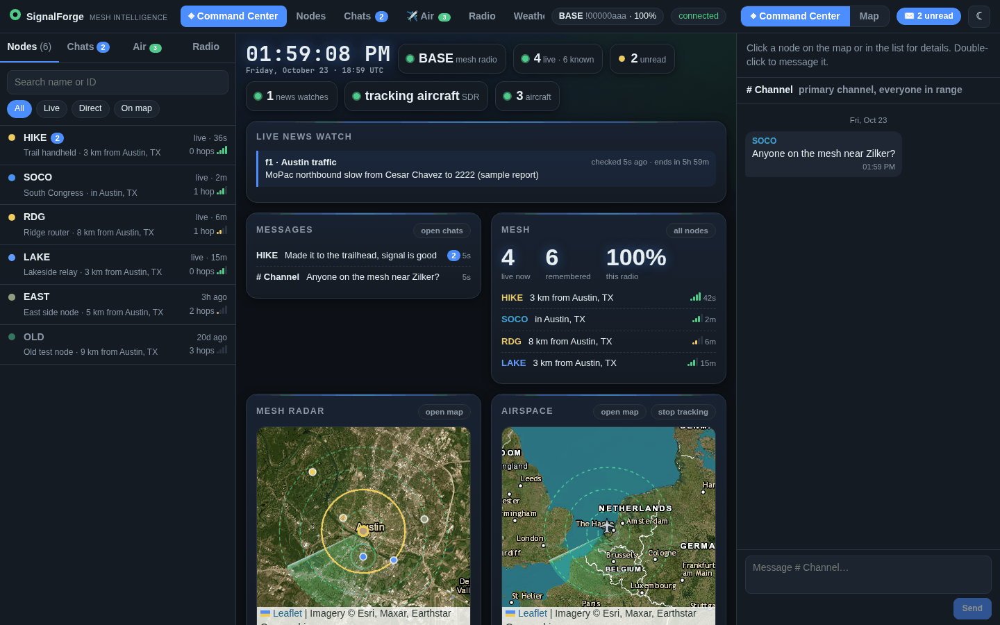
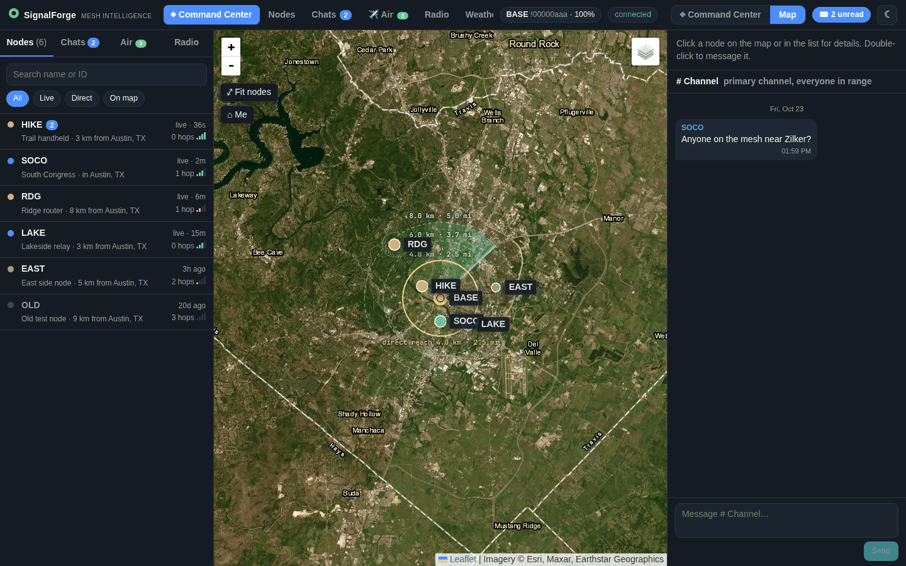
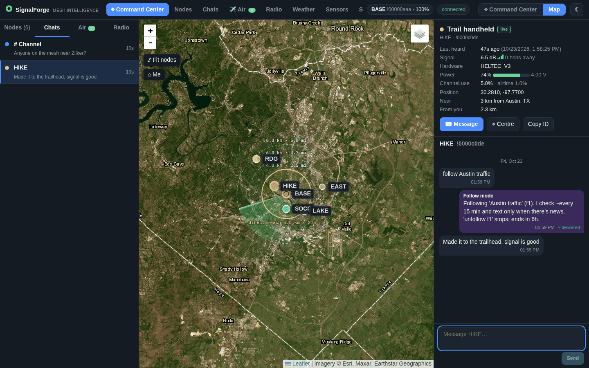
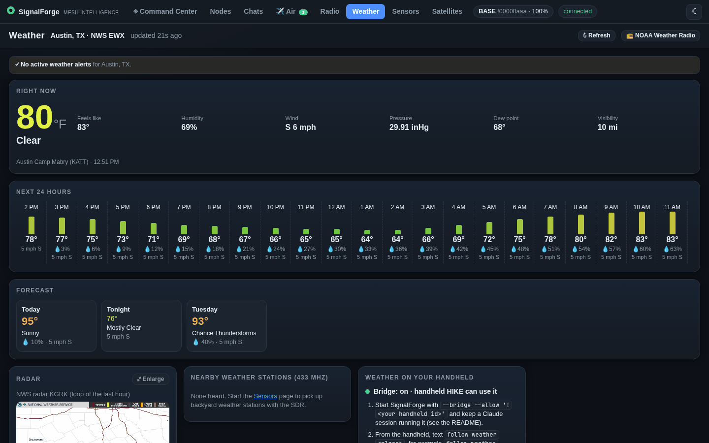
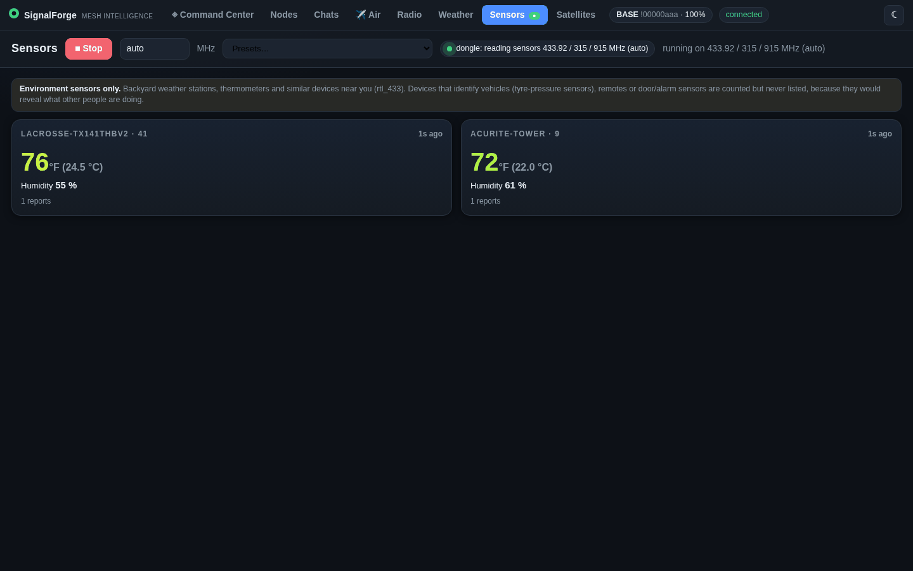

# SignalForge

### Mesh intelligence for the airwaves around you.

SignalForge is a local operator console for one USB-attached Meshtastic radio and one RTL-SDR receiver.
It runs as a single Python process on your computer and serves a browser dashboard on `127.0.0.1`.
From that dashboard you can see and message the nodes on your mesh, and watch what the SDR hears:
aircraft, weather sensors, and activity across common VHF/UHF bands. It also shows NWS weather
and satellite passes for your location.

It is for someone with a Meshtastic radio on their desk (or laptop) who wants one screen for the mesh and
the radio environment around them. It also lets an AI assistant session (Claude Code) chat with a remote
Meshtastic handheld through your radio ("bridge mode").

**What transmits:** only Meshtastic text messages that you send (browser, terminal UI, or the bridge
outbox). The SDR side is receive-only. SignalForge never changes radio configuration or flashes firmware.

## What it looks like

These screenshots use the built-in fake radio and sample data (made-up nodes around downtown Austin,
canned weather, and the test suite's sample aircraft, which happen to be over the Netherlands).

**Command Center**: one screen with your mesh, messages, followed topics, aircraft and the clock.



**Map**: every node your radio knows, range rings, and how far you can reach directly.



**Chats**: click a node to see its details and message it.



| Weather (US National Weather Service) | Sensors (nearby weather stations, via the SDR) |
| --- | --- |
|  |  |

## New to this? Step-by-step

You don't need to be a programmer. You will type a few commands into a **terminal** (the text window
where you type commands). Copy each grey box exactly, paste it into the terminal, and press Enter.

**What you need**

- A computer running **Linux**. This is the only system it has been tested on. A Mac may work but is
  untested. On Windows, use WSL (Ubuntu); the demo should work there, but connecting a USB radio
  through WSL takes extra setup.
- **Python 3** (tested with 3.14), **git** and **make**. Check what you have:
  ```sh
  python3 --version && git --version && make --version
  ```
  If any of those print "command not found", install them. On Ubuntu or Debian:
  `sudo apt install python3 python3-venv git make`. On Arch: `sudo pacman -S python git make`.
- Optional: a Meshtastic radio with a USB cable (for example a Heltec V3) and an RTL-SDR USB dongle.
  **You can try everything first without any hardware** (step 3).

**1. Download SignalForge** (once):

```sh
git clone https://github.com/jordanistan/signalforge.git signalforge
cd signalforge
```

**2. Install it** (once; takes a few minutes and uses about 650 MB of disk):

```sh
make setup
```

**3. Try it with a pretend radio** (no hardware needed):

```sh
make demo
```

The terminal prints a line starting `Open http://127.0.0.1:8765/?token=...`. Copy that **whole** address
into your web browser. The `?token=...` part is your password, so don't share it. Opening the address
without it shows `401 Unauthorized`; that is expected. Press `Ctrl+C` in the terminal to stop.

**4. Use your real radio.** Plug the Meshtastic radio in with USB. Then let your user account use USB
serial devices (once), and **log out and back in** afterwards:

```sh
sudo usermod -aG dialout "$USER"     # Ubuntu/Debian. On Arch use: uucp
```

Check that everything is detected. This only reads; it never changes your radio:

```sh
make doctor
```

Start SignalForge with your approximate location (latitude,longitude, from any online map; it centres
the map and sets your weather):

```sh
make run LOCATION=40.7128,-74.0060
```

Open the address it prints, just like in step 3. To run it in the background instead, use
`./start.sh` and `./stop.sh`. `./signalforge.sh url` prints the address again if you lose it.

**If something goes wrong**

| You see | Do this |
| --- | --- |
| `401 Unauthorized` in the browser | Use the full address that includes `?token=`. It's also saved in `run/web-url.txt`. |
| `Permission denied: /dev/ttyUSB0` | You skipped logging out and back in after step 4. |
| `Cannot listen on 127.0.0.1:8765` | SignalForge is already running. Open the address in `run/web-url.txt`, or run `./stop.sh`. |
| Radio not found | Try another USB cable (some are charge-only) and run `make doctor`. |
| Weather or satellites say "unavailable" | Weather only works in the US and needs internet. The rest still works. |

The sections below give the same steps with more detail and every option.

## What you can use it for

| Use | What you get | Needs |
| --- | --- | --- |
| Mesh awareness | Every node your radio knows: position, distance, SNR, hops, battery, last heard. Range rings and the observed direct reach on a map. | Meshtastic radio |
| Messaging | Per-node direct-message threads with delivery state, plus channel broadcasts. | Meshtastic radio |
| Remote assistant | A remote handheld texts questions; a Claude Code session answers over the mesh (bridge mode). | Radio + Claude Code |
| Topic follows | The handheld texts `follow <topic>`; the assistant session checks it periodically and texts only real updates. | Radio + Claude Code |
| Aircraft tracking | ADS-B on 1090 MHz: callsign, altitude, speed, heading, climb, distance and bearing, on a radar map. | RTL-SDR + 1090 MHz antenna |
| Band survey | Periodic sweeps of six VHF/UHF bands; lists active channels by duty cycle and peak level. | RTL-SDR |
| Radio listening | Narrow-FM audio of one frequency (24 to 1766 MHz) streamed to the browser. | RTL-SDR |
| Weather sensors | Nearby home weather stations and thermometers; auto-scans 433.92/315/915 MHz. | RTL-SDR |
| Weather | NWS current conditions, alerts, hourly and 7-day forecast, radar loop (US only). | Internet |
| Satellites | Where the ISS, weather and amateur satellites are, and your next passes. | Internet once, then cached |

Full details and limits: [docs/USER-GUIDE.md](docs/USER-GUIDE.md). Signals, antennas and hardware:
[docs/HARDWARE.md](docs/HARDWARE.md).

## Quick start: demo mode (no hardware)

Demo mode uses a fake radio with sample nodes. It needs no radio, SDR, or internet feeds, and keeps its
files in `run/demo/`, apart from real history. Outgoing messages are labelled as simulated.

```sh
git clone https://github.com/jordanistan/signalforge.git signalforge
cd signalforge
make setup                 # creates .venv and installs requirements-dev.txt
make demo                  # same as: .venv/bin/python tools/meshweb.py --demo
```

Open the **full URL printed in the terminal**. It looks like `http://127.0.0.1:8765/?token=...`.
The bare `http://127.0.0.1:8765/` answers `401 Unauthorized` on purpose: the page can transmit on your
radio, so it requires the token. The token is saved in `run/web-url.txt` (mode 0600) and reused on
restart. After the first visit the browser keeps it in a cookie and removes it from the address bar.

Demo mode disables the SDR, weather and satellite panels.

## Full start: mesh radio, SDR, weather and satellites

Tested on Linux (Arch-based Omarchy) with Python 3.14. Other systems are untested.

1. **Install.** `make setup` installs everything, including the optional satellite (`skyfield`) and
   aircraft (`pyModeS`) packages. For the SDR features, install the system programs:
   ```sh
   sudo pacman -S rtl-sdr ffmpeg rtl_433      # Arch; verified package names
   ```
   Other distributions: see [docs/HARDWARE.md](docs/HARDWARE.md#software-per-signal).
2. **Serial access.** Add yourself to the serial group, then log out and back in:
   ```sh
   sudo usermod -aG uucp "$USER"       # Arch. Debian/Ubuntu use: dialout
   ```
3. **Plug in** the Meshtastic radio (a Heltec V3 appears as `/dev/ttyUSB0`) and the RTL-SDR dongle.
4. **Check** without touching the hardware:
   ```sh
   make doctor
   ```
   It lists every SDR mode with its frequencies, the program it needs, whether it is ready, and the
   install command if not. It also shows whether the radio and dongle are plugged in, which process
   holds them, and warns if the DVB-T TV driver is loaded. It never opens either device.
   `.venv/bin/python tools/doctor.py --json` gives the same as JSON.
5. **Run** the full console with your own location (latitude,longitude in decimal degrees):
   ```sh
   make run LOCATION=40.7128,-74.0060
   ```
   Variables: `LOCATION` (default `30.267,-97.743`, downtown Austin), `SERIAL` (default
   `/dev/ttyUSB0`), `HTTP_PORT` (default `8765`). This runs
   `tools/meshweb.py -p $SERIAL --http-port $HTTP_PORT --home $LOCATION` with every installed feature.
   To run it in the background instead, use `./signalforge.sh start` (same variables, e.g.
   `LOCATION=40.7,-74.0 ./signalforge.sh start`), then `./signalforge.sh stop` when done. It also has
   `restart`, `status` (who holds the radio), `url` and `logs` (`run/signalforge.log`), and
   `start --bridge` / `start --demo` pass through. `make start`, `make stop` and `make status` call it,
   and so do the shortcuts `./start.sh [args]` and `./stop.sh`.
6. Open the printed `?token=` URL (also in `run/web-url.txt`). Start SDR features from the Air, Radio
   and Sensors pages, or from the Command Center cards.

If port 8765 is already taken (usually a copy that is already running), the server exits with status 3
and a plain message before touching the radio. Open the URL in `run/web-url.txt`, or pick another
`HTTP_PORT`.

`--home` sets where the map centres and where aircraft distances, weather and satellite passes are
computed. If the radio has a GPS fix, that position is used for weather and satellites instead.
Without either, SignalForge falls back to a labelled "assumed" location (downtown Austin, TX).

### All `meshweb.py` options

| Option | Default | Meaning |
| --- | --- | --- |
| `-p`, `--port PORT` | `/dev/ttyUSB0` | Serial device of the Meshtastic radio. |
| `--http-port N` | `8765` | Browser port. Always bound to `127.0.0.1`. Exits with status 3 if the port is busy. |
| `--home LAT,LON` | none | Your location (see above). |
| `--bridge` | off | Also act as the Claude bridge: print `MSG`/`FOLLOW`/... lines on stdout and send files from `run/outbox/`. |
| `--allow ID ...` | `!02ecdcdc` | Node IDs the bridge accepts (`!` plus 8 lowercase hex digits). **Pass your own.** |
| `--demo` | off | Fake radio and sample nodes; no SDR, weather or satellites. State in `run/demo/`. |
| `--no-radio` | off | Do not offer the SDR features. |
| `--no-weather` | off | No NWS requests. |
| `--no-sats` | off | No satellite calculations or CelesTrak downloads. |
| `--state-dir DIR` | `run/` | Where messages, nodes, follows, outbox, the survey summary and the token URL live. Made owner-only (0700) at start. |
| `--debug-ui` | off | Log browser clicks, page changes, JS errors and failed map tiles as `UIDEBUG` lines and to `<state-dir>/ui-debug.jsonl` (rate-limited, rotates at 5 MB). Never logs the token or typed text. |
| `--new-token` | off | Rotate the access token; open the newly printed URL. |

Mesh-only, no network feeds: `--no-radio --no-weather --no-sats`.

### Run as a background service (optional)

`deploy/signalforge.service` is a systemd **user** unit (no root) that runs the full console without
the bridge. Edit it first: it assumes the project is in `~/Work/Meshtastic`, the radio is on
`/dev/ttyUSB0`, and `--home 30.267,-97.743`.

```sh
mkdir -p ~/.config/systemd/user
cp deploy/signalforge.service ~/.config/systemd/user/
systemctl --user daemon-reload
systemctl --user enable --now signalforge     # start now and at login
loginctl enable-linger "$USER"                # optional: keep running while logged out
cat run/web-url.txt                           # the token URL to open
journalctl --user -u signalforge -f           # logs
```

The service owns the radio and the dongle. **Stop it before** `make run-bridge`, `meshtui.py` or
`mesh-bridge.py`, and start it again afterwards:

```sh
systemctl --user stop signalforge
systemctl --user start signalforge
```

It restarts after a crash, but not on exit status 2 (bad arguments) or 3 (port 8765 already in use).

### Bridge mode (Claude Code chats with a remote handheld)

```sh
make run-bridge ALLOW='!abcd1234' LOCATION=LAT,LON
tools/mesh-reply.sh 'Short reply, 180 bytes or less.'
```

`make run-bridge` is `make run` plus `--bridge --allow $ALLOW`. Its `ALLOW` default is the author's
handheld (`!02ecdcdc`), so always pass your own.

Text from allowed nodes is printed as `MSG from !abcd1234: ...`; everyone else is logged as `IGNORED`.
`mesh-reply.sh` queues a reply in `run/outbox/`, which the server sends to the first `--allow` node.
The server does no research itself. See [docs/USER-GUIDE.md](docs/USER-GUIDE.md#bridge-and-follow-mode)
for the event lines, follow mode, and the rules the assistant must follow. `CLAUDE.md` has the exact
workflow used with Claude Code.

### Other front ends

Each of these owns the serial port, so run only one at a time:

```sh
.venv/bin/python tools/meshtui.py --home LAT,LON       # terminal UI (SSH-friendly)
.venv/bin/python tools/mesh-bridge.py --allow '!abcd1234'   # headless bridge, no browser
```

## Safety and security, in short

- Loopback only (`127.0.0.1`). To use it from another device, use an SSH tunnel; do not expose the port.
- Every request needs the token; Host and Origin headers are checked (blocks DNS rebinding and cross-site use).
- Strict Content Security Policy. Mesh text is untrusted and rendered as plain text only.
- Browser sends are limited to 20 messages per minute.
- Radio messages to the bridge are questions, never commands. Sender IDs are not authenticated.

More: [docs/USER-GUIDE.md](docs/USER-GUIDE.md#security-model).

## Documentation

| Document | For |
| --- | --- |
| [docs/USER-GUIDE.md](docs/USER-GUIDE.md) | Use cases, page-by-page tour, bridge/follow mode, troubleshooting, security model. |
| [docs/HARDWARE.md](docs/HARDWARE.md) | Radios, SDR dongle, antennas, every signal and the program that decodes it. |
| [docs/OPERATIONS.md](docs/OPERATIONS.md) | State files, recovery, feed freshness, hardware acceptance checklist. |
| [docs/STATUS.md](docs/STATUS.md) | Verification record and known limits. |
| [docs/HANDOFF.md](docs/HANDOFF.md) | Open items for the next contributor. |
| `CLAUDE.md` | Architecture and bridge rules for AI coding assistants. |

## Project map

```text
tools/meshweb.py        browser server; owns the radio; bridge mode
tools/meshcore.py       shared serial backend, routing, UTF-8-safe message splitting
tools/meshtui.py        terminal UI
tools/mesh-bridge.py    headless bridge
tools/mesh-reply.sh     queue a bridge reply (180-byte limit)
tools/meshfollow.py     follow-topic store and CLI
tools/radiowatch.py     SDR manager: survey, listen, ADS-B, sensors (one at a time)
tools/adsb.py           ADS-B decoding and position validation
tools/decoders.py       sensor (rtl_433) parser
tools/weather.py        NWS client
tools/satellites.py     CelesTrak TLE cache and pass predictions
tools/sdrscan.py        standalone gqrx scanner (not used by the browser)
tools/doctor.py         read-only diagnostics (make doctor)
tools/build_basemap.py  builds data/basemap.json (offline map)
deploy/signalforge.service  systemd user unit (console without bridge)
web/                    browser UI, no build step
run/                    private runtime state (gitignored)
tests/                  fake-radio and fake-SDR tests
```

## Development

```sh
make verify        # syntax checks + full test suite (browser tests need /usr/bin/chromium)
make test-unit     # everything except the browser tests
```

Tests use fake radios, fake SDR processes and canned feed data. They never transmit, flash firmware,
or contact live services.

Contributions are welcome. Keep changes small and tested. Never commit `run/`, `backups/`, `firmware/`
or `data/raw/`: they hold the access token, message history, node positions and radio configuration
that can include private keys. SDR features stay receive-only, mesh text stays untrusted, and anything
that transmits must be an explicit operator action.

Firmware upgrades are a separate, manual operation (`tools/upgrade-heltec-v3.sh`); back up the radio
configuration first.

SignalForge is a local operator tool. Remote access, multi-user authentication and unattended
deployment are out of scope.
